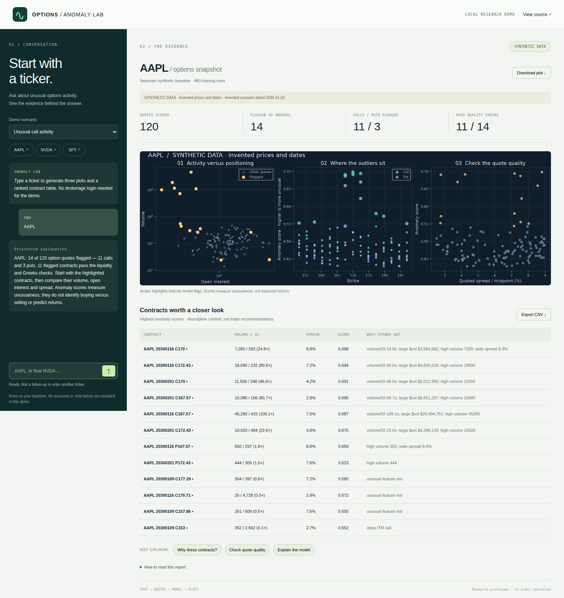

# Options Anomaly Lab

**Type a ticker. Get an options-anomaly report, three plots, and answers grounded in the results.**

**[Open the hosted demo → cbring.synology.me/options-anomaly/](https://cbring.synology.me/options-anomaly/)**

The hosted demo uses real market quotes from the owner's TWS connection. If TWS is closed, it shows **“TWS connectivity is not available”** and displays the last saved run with its original collection date. The initial saved runs were imported from the original collector's October 23, 2026 snapshots and rescored by the demo. A new successful scan replaces that ticker's saved report. Missing data is never silently replaced with synthetic quotes. Live, delayed and frozen feed types are labeled when provided by TWS; imported snapshots whose feed type was not recorded are labeled accordingly.

A standalone demo of a chat-driven options research workflow: ticker → option quotes → anomaly models → plots → explanation. It extracts the scoring engine from an existing TWS options-flow project and adds a portable chat interface. The original WhatsApp connection has not been reconstructed; this repository demonstrates the analysis workflow in a local browser and through a machine-readable CLI.



The default **local** experience needs **no brokerage account, paid API, model download or credentials**. Its prices, dates, volumes and positions are generated fixtures. The screenshot above shows this synthetic local mode. AAPL, NVDA and other symbols in local synthetic mode are labels for fictional scenarios, not current market observations.

## Run the demo

Python 3.11–3.13, using a current patch release (local validation used 3.12.13):

```bash
git clone https://github.com/csbring/options-anomaly-demo.git
cd options-anomaly-demo
python -m venv .venv
source .venv/bin/activate
pip install -e .
options-demo --serve
```

Open **http://127.0.0.1:8781**. On Windows activate with `.venv\Scripts\activate`. On Ubuntu, install the matching `python3-venv` package if environment creation reports that ensurepip is missing.

1. Send `AAPL`, `$NVDA`, or `flow SPY`.
2. Compare the activity, strike and spread plots. Inspect the ranked contracts.
3. Ask `why`, `calls`, `puts`, `quality`, or `model`.
4. Switch between unusual calls, unusual puts, and activity with poor spreads.
5. Download the plot or export the scored quotes as CSV.

By default explanations are structured text derived from the report. Optional Ollama support adds generated prose and free-form questions; it does not calculate or change scores.

## CLI and chat gateways

```bash
options-demo 'flow AAPL' --scenario call_activity --out outputs
```

This prints one JSON object to stdout and writes a PNG, CSV and JSON report into `outputs/` (gitignored). The JSON contains `summary`, `rows`, `chart_path` and `csv_path`. Diagnostics go to stderr and failures return a nonzero exit code.

An existing local chat gateway can validate a ticker, execute this command with an **argument array**, read the JSON, and attach the PNG. See [the adapter contract](docs/CHAT_GATEWAY.md). No WhatsApp session, phone number, message archive, bot token, or live chat sender is shipped. Browser chat and CLI both run the same analysis code.

## Optional: local model

With Ollama running locally and a model already installed:

```bash
export OLLAMA_MODEL='your-installed-model'
options-demo --serve
```

Only localhost Ollama URLs are accepted. `OLLAMA_URL` defaults to `http://127.0.0.1:11434`. If the model is unavailable, supported questions fall back to structured explanations. Free-form questions require a working model. Generated interpretations are labeled and may be wrong; the plots, numeric summary and table remain the authoritative output. The CLI exports structured findings and does not call the model.

## Optional: your own TWS connection

```bash
pip install -e '.[tws]'
export TWS_PORT=7497  # set to the socket port configured in your TWS
export TWS_CLIENT_ID=76
options-demo --serve --source tws
```

Enable the socket API and **Read-Only API** in your own TWS/IB Gateway. Relevant market-data subscriptions are required. `TWS_HOST` defaults to `127.0.0.1`; `TWS_MARKET_DATA_TYPE` defaults to `1` (request live). Values 2, 3 and 4 request frozen, delayed and delayed-frozen data. The report records the type TWS actually returns, including delayed/frozen labels; requesting live does not guarantee fresh quotes.

The adapter requests at most **48 option contracts** (two expirations, 12 nearby strikes, both sides), cancels subscriptions, and disconnects. Collection is bounded by a 55-second timeout. It disables account/order startup fetches and provides no order endpoints. Runtime output contains selected quote fields only. This adapter has mocked integration coverage; a fresh live scan remains **unverified while the owner's TWS is closed**. Connectivity failures and unusable quote snapshots are distinguished, and an available saved report is displayed with its original timestamp.

In TWS mode successful reports are saved privately under `~/.local/share/options-anomaly-demo/reports` (override with `OPTIONS_REPORT_DIR`). Up to 50 ticker reports survive restarts. Synthetic results are not saved there. The browser loads the latest saved report on arrival, then attempts a fresh scan when you enter a ticker. A failed scan never overwrites a successful saved run or substitutes a different ticker's result. TWS scans return a structured explanation immediately; optional local-model follow-ups run separately.

TWS mode fits each side's **current snapshot** because this public demo contains no historical cache. Synthetic mode trains on a separate generated baseline of 480 rows. These are different modeling regimes and are labeled in every report.

References: [ib_async API](https://ib-api-reloaded.github.io/ib_async/api.html), [IBKR market-data types](https://interactivebrokers.github.io/tws-api/market_data_type.html).

## What the model does

Separate call/put [Isolation Forests](https://scikit-learn.org/stable/modules/generated/sklearn.ensemble.IsolationForest.html) use median/IQR scaling and eight features: DTE, distance from spot, spread, log volume, log open interest, volume/OI, log estimated notional, and midpoint change versus previous close. The default contamination setting is 8%; it defines a threshold, not a likelihood of profitable trading. Current-snapshot fitting can flag a fixed fraction even without a meaningful market event.

Higher scores mean more unusual feature combinations. The report separately checks liquidity, spreads, Greeks and missing OI. Missing OI does not produce an infinite volume/OI ratio. Invalid, crossed, non-finite and overly wide quotes are excluded. The legacy engine's internal `actionable` field is only a quote/liquidity screen; the public UI calls this “pass quality checks.”

This is **snapshot anomaly research**, not trade-by-trade order flow. Volume cannot identify aggressor direction, buyer/seller intent, hedging, or multi-leg positions. Estimated notional uses volume × midpoint × 100, not observed execution prices. Reasons are descriptive rules, not causal model explanations. There is no predictive-performance or profitability claim.

## Architecture and validation

```text
Browser chat / CLI
        ↓
Strict ticker parser
        ↓
Synthetic generator OR bounded TWS adapter
        ↓
Quote validation → robust features → call/put Isolation Forests
        ↓
Quality checks → ranked contracts → three Matplotlib plots
        ↓
Structured answers / optional local Ollama interpretation
```

The original research sources remain separate. Only six allowlisted engine modules were extracted; credentials, account data, collected quotes, caches, trained models and private chat history were excluded. [Provenance and differences](docs/PROVENANCE.md).

```bash
pip install -e '.[dev,tws]'
pytest -q
```

Tests cover scenario behavior, invalid quotes, missing OI, chat follow-ups, request boundaries, model fallback, and bounded TWS subscription cleanup with a fake broker. [Release validation](docs/VALIDATION.md).

The CLI server binds to loopback. The separate [Synology deployment](deploy/README.md) uses a gateway-authenticated backend with bounded requests, one active analysis and rate limits. It publishes quote reports only; no account endpoints or messaging credentials are exposed. Chat context IDs remain in memory, limited to 16 reports and 30 minutes. Saved TWS reports persist separately. Runtime data and gateway configuration are outside this Git repository.
